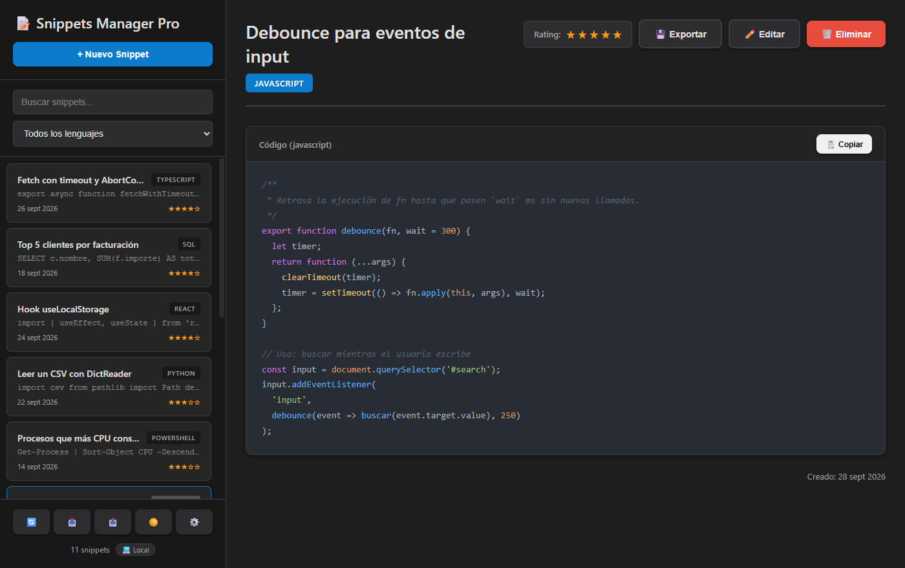
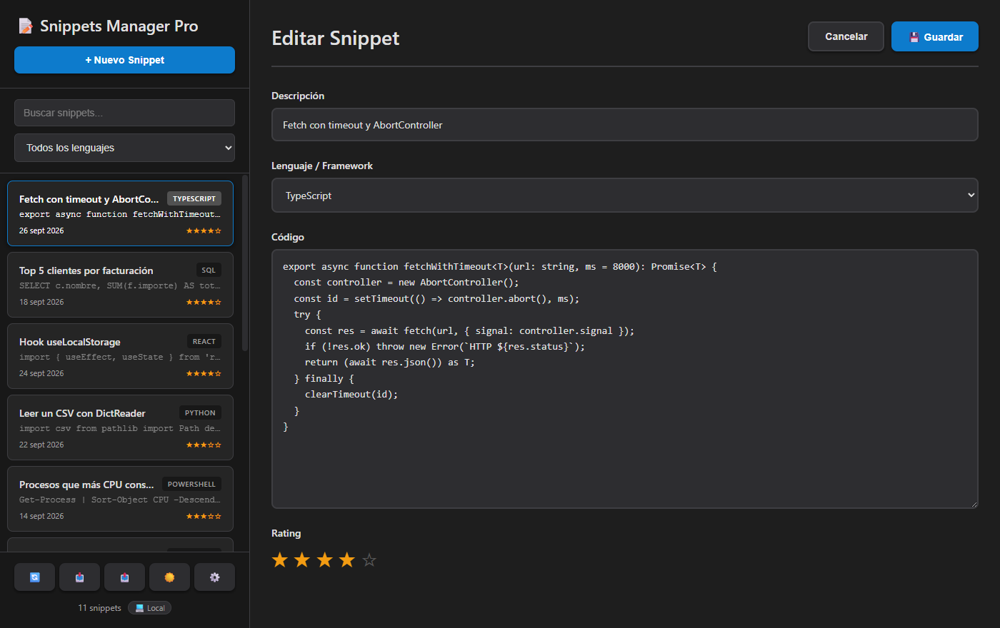
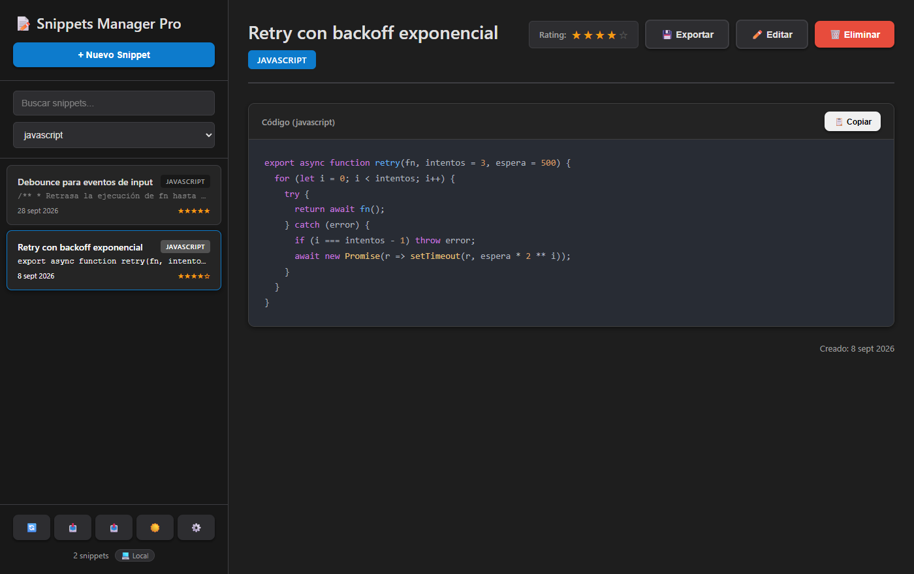
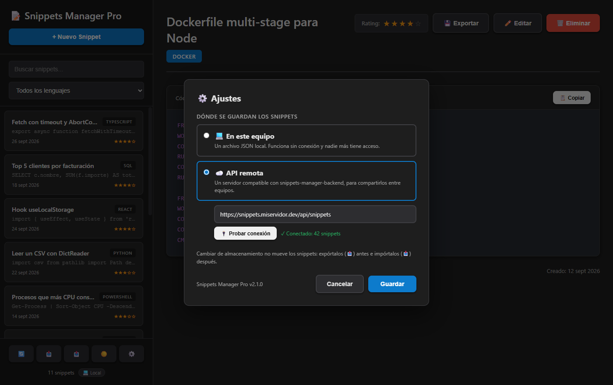
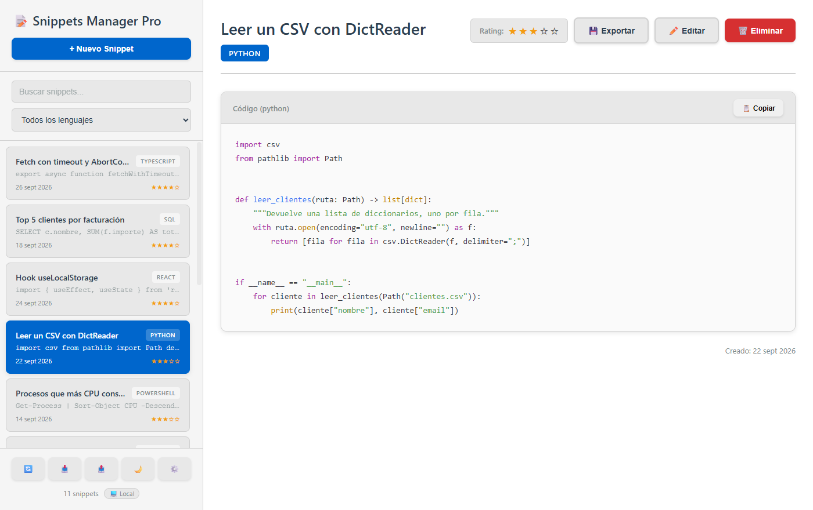

# 📝 Snippets Manager Pro

Aplicación de escritorio (Electron) para guardar, buscar y reutilizar snippets de código: resaltado de sintaxis para 30+
lenguajes, búsqueda y filtro por lenguaje, rating, importar/exportar y almacenamiento **local** (por defecto, sin
conexión) o en **tu propia API**.

🌐 **Web y descargas:** https://cmurestudillos.github.io/snippets-manager/ · 📦
[Versiones](https://github.com/cmurestudillos/snippets-manager/releases)


## Capturas

| Vista principal                                      | Edición                                          |
| ---------------------------------------------------- | ------------------------------------------------ |
|  |  |

| Filtro por lenguaje                                            | Ajustes                                          | Tema claro                                           |
| -------------------------------------------------------------- | ------------------------------------------------ | ---------------------------------------------------- |
|  |  |  |

## Características

- **Almacenamiento local por defecto**: `snippets.json` en la carpeta de datos de la app (en Windows
  `%APPDATA%\snippets-manager\`). Sin red ni cuentas. Si el archivo se daña, la app avisa y no lo sobrescribe.
- **API remota opcional** (⚙️ Ajustes): cualquier servidor compatible con `snippets-manager-backend`, con token
  opcional y botón para probar la conexión.
- **Resaltado de sintaxis** con highlight.js incluido en la app (sin CDN), tema oscuro y claro.
- **Búsqueda** por descripción y código, **filtro por lenguaje** y **rating** de 1 a 5 estrellas.
- **Importar / exportar** toda la colección en JSON (importación en lote; en modo API, una sola petición a
  `POST /importar`) y **exportar un snippet** como archivo con su extensión y una cabecera comentada válida para su
  lenguaje.
- **Atajos de teclado** y **aviso de cambios sin guardar** (también al cerrar la ventana).

### Atajos de teclado

| Acción                                                   | Atajo (en macOS, ⌘) |
| -------------------------------------------------------- | ------------------- |
| Nuevo snippet                                            | `Ctrl+N`            |
| Buscar                                                   | `Ctrl+F`            |
| Guardar (en el formulario)                               | `Ctrl+S`            |
| Editar el snippet abierto                                | `Ctrl+E`            |
| Cancelar la edición · limpiar la búsqueda · cerrar Ajustes | `Esc`             |

## Instalación

Descarga el instalador de tu sistema desde la [web](https://cmurestudillos.github.io/snippets-manager/#/descargas):
`.exe` (Windows), `.dmg` (macOS, Apple Silicon) o `.AppImage` (Linux). Los instaladores no están firmados: en Windows,
_Más información → Ejecutar de todas formas_; en macOS, `xattr -cr "/Applications/Snippets Manager Pro.app"`; en
Linux, `chmod +x Snippets-Manager-Pro-*.AppImage`.

## Desarrollo

Requisitos: Node.js 22.12+ y pnpm 11+.

```bash
pnpm install
pnpm start            # ejecutar en desarrollo (pnpm start -- --dev abre DevTools)
pnpm lint             # ESLint (0 errores)
pnpm format           # Prettier
pnpm package:win      # instalador de Windows en release/
pnpm package:mac      # .dmg (solo desde macOS)
pnpm package:linux    # AppImage (Linux o Docker)
```

### Estructura

```
src/
├── main.js            # proceso principal: ventana, diálogos e IPC
├── preload.js         # puente IPC seguro (contextIsolation)
├── renderer.js        # interfaz: lista, vistas, filtros, atajos y Ajustes
├── index.html         # estructura de la ventana (CSP estricta)
├── settings.js        # ajustes en userData/settings.json
├── storage/
│   ├── local-store.js # snippets en userData/snippets.json
│   ├── api-store.js   # cliente de la API REST (axios)
│   └── validate.js    # validación compartida
└── assets/            # iconos y estilos
docs/                  # landing (GitHub Pages), no se incluye en el instalador
.github/workflows/     # release.yml (instaladores) y pr-review.yml
```

### API remota

Si usas el modo API, el servidor (URL base, p. ej. `https://mi-servidor.com/api/snippets`) debe responder a
`GET /` → `{ "snippets": [...] }`, `POST /` y `PUT /:id` → `{ "snippet": {...} }`, `PATCH /:id/rating`,
`DELETE /:id` y, opcionalmente, `POST /importar`. El backend de referencia ignora `rating` en POST/PUT, así que la app
lo guarda con `PATCH`.

Si pones un **token** en Ajustes, la app lo manda en cada petición como `Authorization: Bearer <token>`; el backend de
referencia lo exige y lo compara con su variable `API_TOKEN`. El token se guarda cifrado en `settings.json` con
`safeStorage` de Electron (DPAPI en Windows, Llavero en macOS, libsecret en Linux), o en claro si el sistema no ofrece
cifrado.

Cambiar de almacenamiento no mueve los snippets: expórtalos (📤) antes e impórtalos (📥) después.

## Capturas de la web: cómo regenerarlas

Las capturas de `docs/assets/screenshots/` son reales. Se generan con un script de Electron **fuera del repositorio**
que se carga antes de `main.js` con `electron -r <script> .`:

1. Al principio del script, `app.setPath('userData', <carpeta temporal>)` y un `snippets.json` con datos de ejemplo
   (así no se tocan los datos reales ni hace falta red).
2. Sustituir solo los handlers IPC que saldrían del equipo (p. ej. `test-api` con `ipcMain.removeHandler` +
   `ipcMain.handle` devolviendo un resultado de ejemplo).
3. Manejar la UI con `webContents.executeJavaScript` (clics, filtros, Ajustes, tema) y, antes de cada
   `capturePage()`, llamar a `webContents.invalidate()` (si no, se captura el fotograma anterior).
4. Ventana a 1400×880 (`setContentSize`) y guardar en PNG con los nombres `01-principal`, `02-edicion`,
   `03-filtro-lenguaje`, `04-ajustes` y `05-tema-claro`.

## Publicar una versión

1. Subir la versión en `package.json` (la app la muestra en Ajustes) y hacer commit en `develop`.
2. Crear el tag anotado, que debe coincidir con `package.json`: `git tag -a v2.1.0 -m "v2.1.0"`.
3. Subir la rama y el tag: `git push origin develop` y `git push origin v2.1.0`.
4. En _Actions_, **Release v2.1.0** crea un borrador y compila Windows, macOS y Linux (~10 min).
5. Revisar el borrador en _Releases_ (`Snippets-Manager-Pro-Setup-X.Y.Z.exe`, `…-X.Y.Z-arm64.dmg`,
   `…-X.Y.Z.AppImage`) y pulsar **Publish release**: la web pasa sola a la nueva versión.

Si un build falla: corregir, borrar el tag (`git tag -d vX.Y.Z && git push origin :refs/tags/vX.Y.Z`), crearlo de
nuevo sobre el commit bueno y subirlo.

## Licencia

MIT — Carlos Mur
